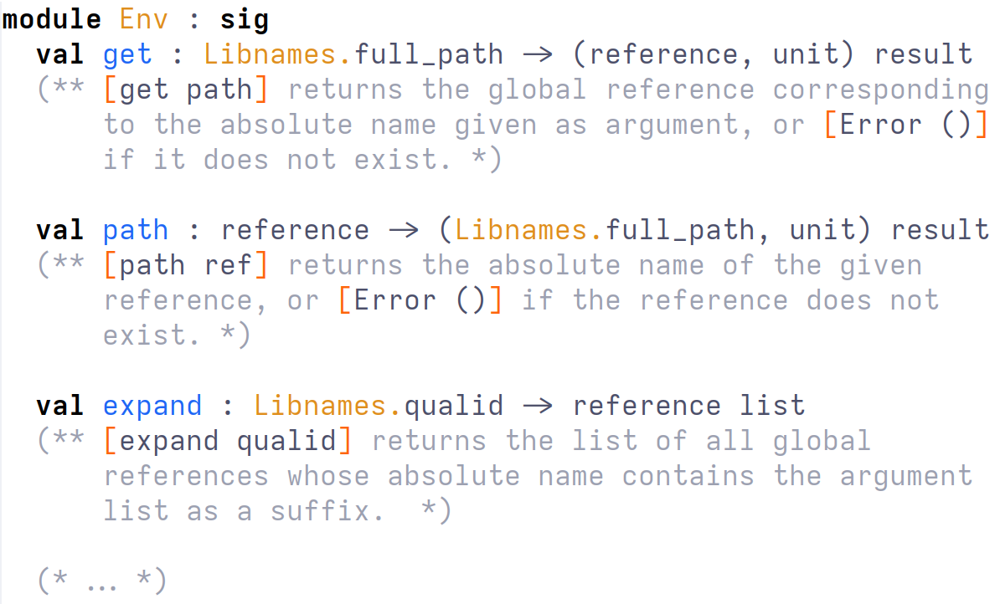

# MLtac2: Ltac2 APIs for OCaml

MLtac2 is a simple library that packages part of the Ltac2 APIs for use in OCaml plugins.

<div align="center">
  
</div>

MLtac2 provides:

1. A set of meta-programming APIs for interacting with Rocq that are guaranteed to be **stable across Rocq versions**;

2. A simple entry-point for meta-programming and discovering Rocq APIs.

## Compatibility guarantees

MLtac2 strives to guarantee *source compatibility*, i.e., code written using MLtac2 will work on later Rocq versions with no changes. We thus keep one version of the Ltac2 APIs per Rocq version, and MLtac2 chooses the correct version at compile-time for your version of Rocq.

In the future, we may add new functions to the API, but we do not modify the signature of existing functions from the API. The only exception to this rule is that **optional arguments** may be added to functions to implement new features. It is thus recommended to not annotate the type of partially applied functions from MLtac2.

## Setup

MLtac2 support Rocq ≥ 9.0, and can be installed using `opam`:
```sh
opam repo add rocq-released https://rocq-prover.github.io/opam/released/
opam install rocq-mltac2
```
